# CampusFlow

**Constraint-based campus scheduling, examination allocation and venue management for the Chilika Institute of Technology (CIT).**

Team **OrchestrAI** · Crunch Week hackathon submission

CampusFlow generates a clash-free weekly timetable, schedules mid-semester exams, decides festival-week venue requests by priority, and repairs the timetable with the fewest possible changes when something breaks. A natural-language assistant (English and Hinglish, text and voice) helps users file requests, but it never decides whether anything is valid. Every decision comes from a deterministic solver and an independent validator.

---

## Built with


| Category | Tool or service | Used for |
|---|---|---|
| Optimisation | **Google OR-Tools (CP-SAT)** | Timetable generation, exam scheduling, minimal-move disruption repair. |
| AI model | **Google Gemini** (`gemini-2.5-flash`) | Understanding and explaining faculty and booking requests. |
| AI agent framework | **Google ADK** (Agent Development Kit) | Building the faculty assistant agent. |
| Speech-to-text | **Sarvam AI** | Voice input for English and Hinglish requests, streamed over WebSocket. |
| Web framework | **Next.js 16**, **React 19** | Dashboards and the REST API routes. |
| Styling | **Tailwind CSS 4**, **Lucide** icons | Responsive UI and iconography. |
| Database | **MongoDB Atlas**, **Mongoose** | Storage for 15 collections and schedule versions. |
| Authentication | **JSON Web Tokens**, **bcryptjs** | Sessions, role checks, password hashing. |
| Python services | **FastAPI**, **Uvicorn** | Solver service and agent service. |
| Validation | **Official CIT `validator.py`** | Independent check of every hard and soft rule. |
| Hosting | **Render**, **Vercel** | Backend services and the frontend. |
| CI and testing | **GitHub Actions**, **pytest**, shell smoke tests | Automated checks on every pull request. |
| Documentation | **Mermaid** | Architecture and algorithm diagrams in this README. |

---

## Screenshots

| Public landing page | Admin: disruption management |
|---|---|
| 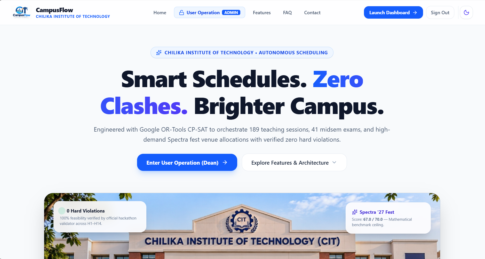 | 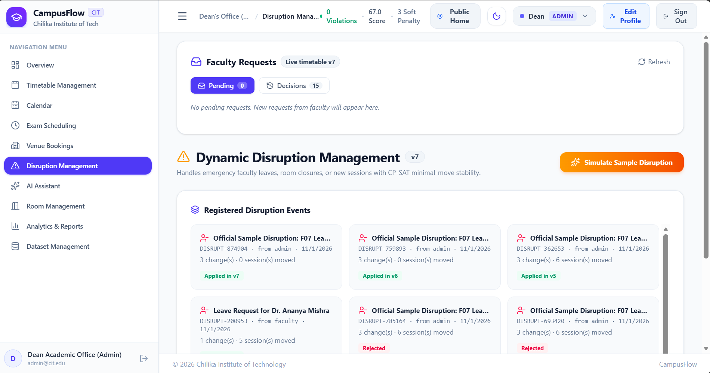 |

| Faculty: calendar with Google Calendar export | Faculty: AI timetable change assistant (Hinglish input) |
|---|---|
| 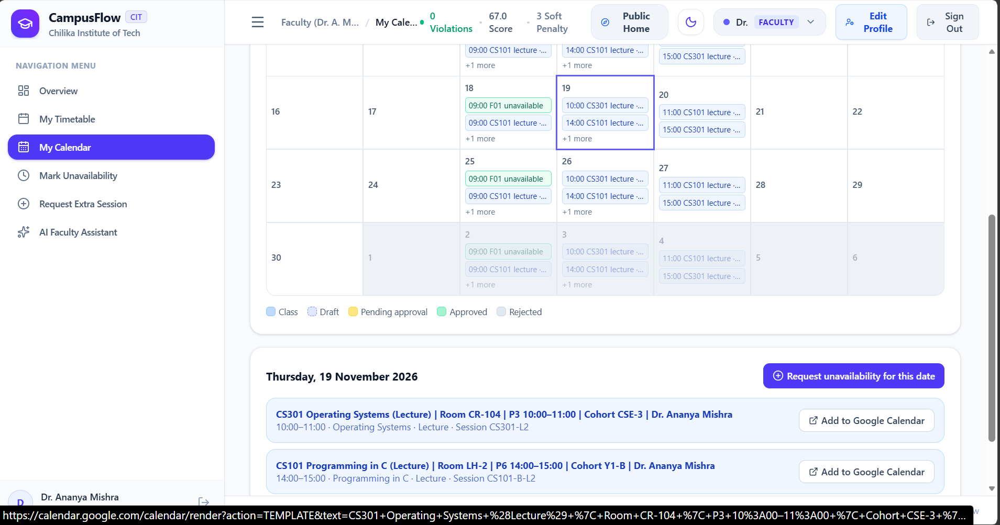 | 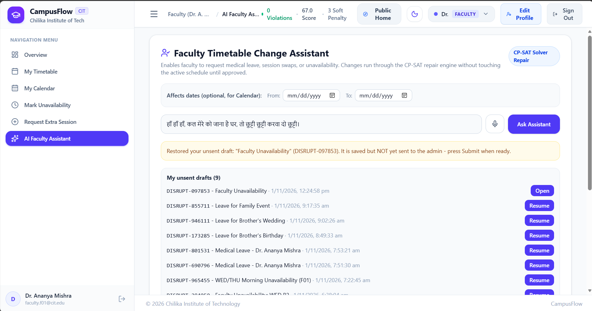 |

---

## Table of contents

1. [Highlights](#1-highlights)
2. [The problem](#2-the-problem)
3. [System architecture](#3-system-architecture)
4. [Technology stack](#4-technology-stack)
5. [Algorithms](#5-algorithms)
6. [AI layer](#6-ai-layer)
7. [Data model](#7-data-model)
8. [Roles and access control](#8-roles-and-access-control)
9. [API reference](#9-api-reference)
10. [Repository structure](#10-repository-structure)
11. [Local setup](#11-local-setup)
12. [Configuration](#12-configuration)
13. [Testing and CI](#13-testing-and-ci)
14. [Deployment](#14-deployment)
15. [Demo accounts](#15-demo-accounts)
16. [Benchmark results](#16-benchmark-results)
17. [Security notes](#17-security-notes)
18. [Known limitations and roadmap](#18-known-limitations-and-roadmap)
19. [Documentation index](#19-documentation-index)

---

## 1. Highlights

| Capability | What it does |
|---|---|
| Timetable generation | Places 189 teaching sessions into days, periods and rooms with zero hard-rule violations (Google OR-Tools CP-SAT). |
| Exam scheduling | Two-stage model: assigns each exam a slot, then seats it across rooms at half capacity. |
| Venue booking | Decides Spectra festival-week requests by role-capped priority, with reasons and alternatives. |
| Disruption repair | Re-solves after a faculty leave or room closure while pinning every unaffected session. |
| Approval workflow | Nothing changes the live timetable until an Admin approves; every approval creates a new schedule version. |
| AI assistant | Parses English and Hinglish requests, explains decisions, and accepts voice input. |
| Auditability | Versioned schedules, an audit log, and an official validator endpoint inside the app. |

---

## 2. The problem

CIT must coordinate the following resources every week:

| Resource | Quantity |
|---|---|
| Rooms (classrooms, lecture halls, auditorium, seminar halls, open-air theatre, labs) | 27 |
| Faculty members | 40 |
| Student groups | 14 |
| Courses | 62 |
| Sessions to schedule | 189 (243 teaching hours per week) |
| Spectra week booking requests | 25 (one is cancelled) |
| Mid-semester exams | 41 |

Doing this by hand produces faculty, group and room clashes, wasted rooms, and slow, disruptive rework whenever a leave or closure appears. The goal is a system that produces a valid schedule, explains its decisions, and changes as little as possible when the plan has to change.

### Time model

- Teaching days are Monday to Friday. Periods **P1 to P9** are one hour each: P1 starts at 08:00, P5 at 12:00, lunch runs 13:00 to 14:00, P6 starts at 14:00 and P9 at 17:00.
- Periods **P10 to P13** (18:00 to 22:00) are reserved for events.
- A session may not span the P5/P6 lunch boundary. Three-hour labs start only at P2 or P6.
- Exam week runs Monday to Saturday with an AM session (09:30 to 11:30) and a PM session (14:00 to 16:00).

---

## 3. System architecture

### 3.1 Logical architecture

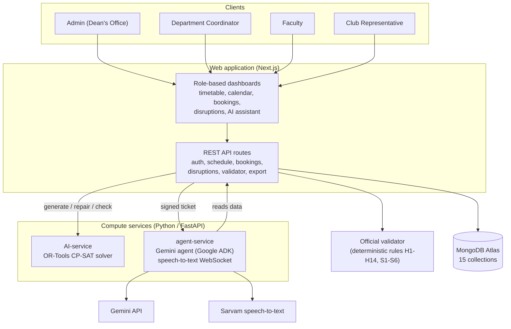

### 3.2 Deployment topology

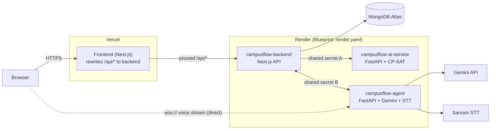

Vercel can proxy ordinary HTTP requests but not WebSockets, so the browser opens the voice-input WebSocket directly to the agent service using a short-lived signed ticket issued by the backend.

### 3.3 Component responsibilities

| Component | Responsibility |
|---|---|
| `frontend/` | Dashboards, timetable and calendar views, booking forms, disruption workflow, AI assistant with microphone input. |
| `backend/` | Authentication and role guards, schedule and booking APIs, disruption workflow, validator runner, exports, audit log, seeding. |
| `AI-service/` | CP-SAT solver for timetables, exams, bookings and minimal-move repair, exposed over FastAPI. |
| `agent-service/` | Gemini-based assistant built on Google ADK, plus the speech-to-text WebSocket. |
| `CrunchWeek_StarterPack/` | Official dataset and `validator.py` that scores every output. |
| `timetablescheduling/` | Extended scheduler package (pipeline, repair, joint solving, progress reporting) with its own FastAPI layer. |
| `exports/` | `schedule.json` and `schedule_after.json`, produced by the app. |

---

## 4. Technology stack

| Layer | Technology |
|---|---|
| Web framework | Next.js 16, React 19 |
| Styling | Tailwind CSS 4, Lucide icons |
| Database | MongoDB Atlas, accessed through Mongoose 9 |
| Authentication | JSON Web Tokens (`jsonwebtoken`), password hashing with `bcryptjs` |
| Optimisation | Google OR-Tools CP-SAT (Python) |
| Python services | FastAPI, Uvicorn |
| AI agent | Google ADK with Gemini, rule-based parser as an offline fallback |
| Voice input | Sarvam speech-to-text over WebSocket, browser AudioWorklet |
| Hosting | Vercel (frontend), Render (three services, defined in `render.yaml`), MongoDB Atlas |
| CI | GitHub Actions |

---

## 5. Algorithms

All scheduling decisions come from constraint programming and deterministic rules. Hard rules are never relaxed; soft rules are optimised.

### 5.1 Rule catalogue

**Hard constraints (must hold, checked by the validator)**

| Rule | Meaning |
|---|---|
| H1 | Every session is scheduled exactly once. |
| H2 | A faculty member cannot teach two sessions at the same time. |
| H3 | A student group cannot attend two sessions at the same time. |
| H4 | A room cannot host two activities at the same time. |
| H5 | Room capacity must fit the session size (exams use half capacity). |
| H6 | Room type must match the session's allowed types. |
| H7 | No session during faculty unavailability. |
| H8 | No session in a room during its unavailability window. |
| H9 | Stay within P1 to P9, never cross lunch, labs start only at P2 or P6. |
| H10 | Accessibility needs must be met. |
| H11 | Sessions sharing an elective `basket_slot` run at the same day and period, in different rooms. |
| H12 | Faculty `max_hours_per_day` is respected. |
| H13 | Festival-week booking rules, including who may displace a regular session. |
| H14 | `fixed_slot` sessions stay exactly where they are fixed. |

**Soft penalties (minimised)**

| Rule | Penalty | Weight |
|---|---|---|
| S1 | Teaching inside a faculty member's avoided day and period | 2 per hour |
| S2 | Free-period gaps inside a student group's day | 1 per gap period |
| S3 | A group taught for more than 6 hours in one day | 3 per extra hour |
| S4 | The same lecture course twice on one day for a group | 3 per extra lecture |
| S5 | A room used below 40% of its capacity | 1 per session |
| S6 | Teaching in the last period (P9) | 1 per session |

### 5.2 Weekly timetable (CP-SAT)

Each session `s` gets one boolean variable for every feasible placement `(day d, start period t, room r)`:

$$x_{s,d,t,r} \in \{0,1\}$$

**Step 1: candidate pruning.** Before the model is built, placements that can never be valid are removed, which keeps the search space small. A placement survives only if the room type matches (H6), the capacity fits (H5), accessibility is satisfied (H10), neither the faculty member nor the room is unavailable (H7, H8), the block stays inside P1 to P9 without crossing lunch and labs start at P2 or P6 (H9), and a `fixed_slot` session keeps only its fixed placement (H14).

**Step 2: model constraints.**

- H1: `AddExactlyOne` over the candidates of each session.
- H2, H3, H4: for each faculty, group and room at each `(day, period)`, the sum of the variables that would occupy it is at most 1.
- H11: one boolean per `(basket, day, period)`. Every session in the basket must equal that boolean, so all basket sessions land at the same time. The boolean also counts toward each affected group's clash constraint, so baskets do not clash with each other but do clash with everything else those groups attend.
- H12: for each faculty member and day, the sum of `x * duration` is at most `max_hours_per_day`.

**Step 3: objective.** The solver minimises the weighted soft penalties it models directly (S1, S5, S6), with eight parallel workers and a time limit (30 seconds for the baseline run). S2, S3 and S4 are measured by the validator and are on the roadmap for the model itself.

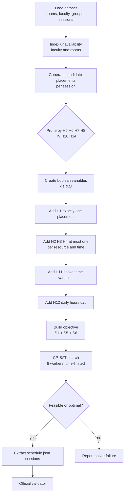

### 5.3 Examination scheduling

Exams are solved in two stages so each stage stays small.

1. **Slot assignment.** One boolean per `(exam, day-session slot)`. Each exam takes exactly one slot, a student group sits at most one exam per slot (H3), and the total students in a slot cannot exceed the combined half-capacity seats of all exam rooms. A soft penalty of 5 per extra exam in one day discourages overloading a group on a single day. This stage has a 10-second limit.
2. **Room assignment per slot.** Within each slot, exams are seated into exam-capable rooms at half capacity. An exam may use several rooms, and a room hosts only one exam per slot (H4, H5).

### 5.4 Venue booking decisions

Booking is decided by a deterministic, priority-ordered procedure rather than by the AI.

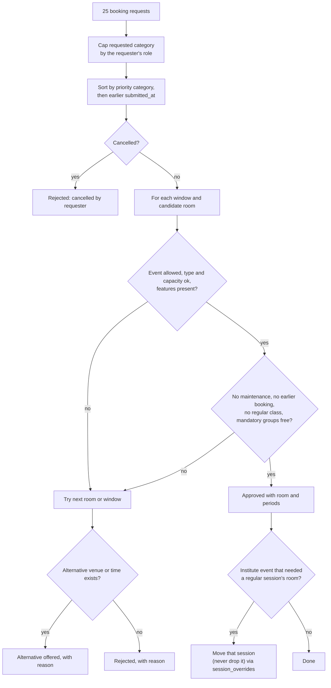

Two rules shape the outcome. First, **category is capped by role**: a club asking for `institute_event` is treated as `club_event`, so it cannot outrank an institute request. Second, ties are broken by submission time. Processing requests in priority order is what keeps the validator's *priority inversion* count at zero.

### 5.5 Disruption repair with minimal movement

When a faculty leave, room closure, added session or removed session arrives, the baseline timetable is re-solved instead of regenerated from scratch.

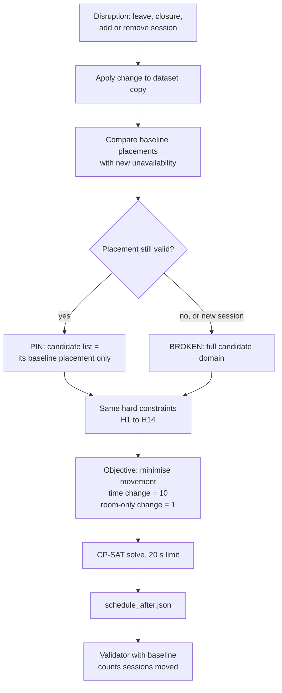

Pinning shrinks the problem to only the sessions that actually broke, which is why repair finishes in under a second. The cost asymmetry (10 versus 1) pushes the solver to fix a problem by changing the room before it changes the time, because a time change disturbs students and faculty, while a room change rarely does.

### 5.6 Disruption approval lifecycle

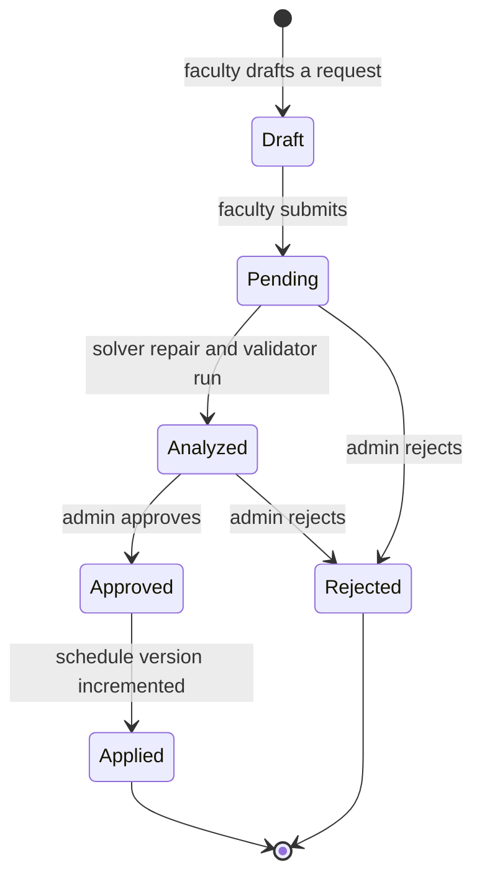

Approval is allowed only from the `Analyzed` state, so an unreviewed or unsolved proposal can never reach the live timetable, and approving twice returns a conflict instead of creating a second version.

---

## 6. AI layer

The AI helps people say what they want. It does not decide anything.

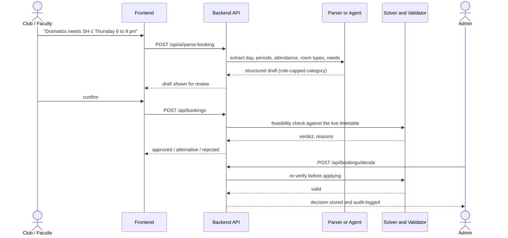

| Part | Detail |
|---|---|
| Rule-based parser (`backend/lib/aiParser.js`) | Reads day, attendance, time ranges (including `6 to 9 pm`, `18:00 to 21:00`, Hindi-style phrasing such as `shaam 6 se 9`, and explicit `P10-P12`), room types, requested room and needs. It also applies the role category cap. It works with no network access. |
| Faculty assistant | Understands leave and rescheduling requests in natural language and turns them into disruption drafts. |
| Explanations | `GET /api/ai/explain` returns a plain-language reason for a decision (for example, why a booking was rejected or why a class sits at 8 AM). |
| Agent service | A Gemini agent built on Google ADK, called by the backend with a shared secret. |
| Voice input | The browser streams audio to the agent's `/ws/stt` WebSocket using a signed ticket, and the transcript fills the request box. |

**Design rule.** The model may draft and explain. The solver and validator decide, and every change to the live timetable still needs an Admin approval. If the AI service is down, the normal forms and the rule-based parser keep working. The full declaration is in [`AI_USAGE.md`](AI_USAGE.md).

---

## 7. Data model

CampusFlow stores everything in **MongoDB** (15 collections, Mongoose models in `backend/models/`).

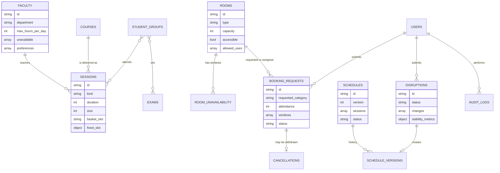

| Collection | Purpose |
|---|---|
| `rooms` | 27 rooms with type, capacity, features, accessibility and allowed uses. |
| `faculty` | 40 faculty with department, daily teaching cap, unavailability and preferences. |
| `student_groups` | 14 groups across Year 1 sections A to D, and Years 2 and 3 for five branches. |
| `courses` | 62 courses (reference information). |
| `sessions` | 189 lecture, tutorial and lab sessions to place. |
| `room_unavailability` | Maintenance and closure windows. |
| `booking_requests` | Spectra week requests and their lifecycle. |
| `cancellations` | Withdrawn requests, which must never be approved. |
| `exams` | 41 mid-semester exams. |
| `institute_config` | Calendar rules, priority order and role category caps. |
| `users` | Accounts for all four roles. |
| `schedules` | The live and saved timetables with approval status. |
| `schedule_versions` | Version history and number of sessions moved. |
| `disruptions` | Registered leaves, closures and added sessions. |
| `audit_logs` | Chronological record of administrative actions. |

---

## 8. Roles and access control

Authentication uses a signed JWT sent as `Authorization: Bearer <token>`. Every protected route checks the role before doing anything.

| Role | Can do | Cannot do |
|---|---|---|
| **Admin** (Dean's Office) | Generate timetables, approve or reject disruptions, decide bookings, run the validator, export schedules, reset demo data. | None of the above is restricted. |
| **Department Coordinator** | Manage department sessions, book department events, view department timetables. | Approve disruptions or decide bookings. |
| **Faculty** | View their own timetable and calendar, mark unavailability, request extra sessions, use the AI assistant. | Approve disruptions (returns 403). |
| **Club Representative** | Submit English or Hinglish venue requests, track status, cancel their own bookings. | Decide bookings (returns 403). |

The booking category a requester may claim is also capped by role, so a club cannot gain institute-level priority by asking for it.

---

## 9. API reference

All routes are under `/api`. Unauthenticated calls to protected routes return 401, and calls from the wrong role return 403.

| Method | Endpoint | Purpose |
|---|---|---|
| POST | `/auth/login` | Sign in and receive a JWT. |
| GET | `/auth/me` | Current user. |
| GET | `/dataset/summary` | Counts and configuration of the loaded dataset. |
| POST | `/schedule/generate` | Run the solver and produce a timetable. |
| GET | `/schedule/current` | The live timetable and version. |
| GET | `/schedule/views` | Timetable by student group, faculty, room, or utilisation. |
| GET | `/bookings` | List booking requests. |
| POST | `/bookings` | Submit a booking request (category capped by role). |
| POST | `/bookings/check` | Solver feasibility check for a proposed booking. |
| POST | `/bookings/decide` | Admin decision on a request. |
| POST | `/bookings/cancel` | Cancel a booking. |
| GET, POST | `/disruptions` | List or register disruptions. |
| POST | `/disruptions/propose` | Faculty proposal; does not change the live schedule. |
| POST | `/disruptions/apply` | Run solver repair and validator, producing an analysis. |
| POST | `/disruptions/approve` | Admin approval; creates the next schedule version. |
| GET | `/validator/run` | Run the official validator on the current schedule. |
| GET | `/export/schedule` | Download `schedule.json`. |
| GET | `/export/schedule-after` | Download `schedule_after.json`. |
| POST | `/ai/parse-booking` | Parse a natural-language booking request. |
| POST | `/ai/faculty-assistant` | Faculty leave and rescheduling assistant. |
| GET | `/ai/explain` | Explain a decision in plain language. |
| GET | `/audit-logs` | Audit trail. |
| POST | `/admin/reset-database` | Reset the demo database to its starting state. |

---

## 10. Repository structure

```text
CampusFlow/
├── frontend/                  Next.js web client (dashboards, voice input, public/ worklet)
├── backend/                   Next.js API, models, auth, seeding
│   ├── app/api/               REST route handlers
│   ├── components/            Dashboard views
│   ├── lib/                   mongodb.js, auth.js, aiParser.js, validatorRunner.js, seed.js
│   ├── models/                Mongoose models (15 collections)
│   ├── scripts/               Seed runner and helpers
│   └── tests/                 smoke.sh end-to-end API checks
├── AI-service/                CP-SAT solver and FastAPI server
├── agent-service/             Gemini (Google ADK) agent and speech-to-text WebSocket
├── timetablescheduling/       Extended scheduler package and FastAPI layer
├── CrunchWeek_StarterPack/    Official dataset and validator.py
├── exports/                   schedule.json, schedule_after.json (generated by the app)
├── render.yaml                Render Blueprint for the three backend services
├── .github/workflows/         CI pipeline
├── AI_USAGE.md                AI usage declaration
├── THIRD_PARTY.md             Third-party libraries and solvers
├── CI-SETUP.md                CI behaviour and branch protection
├── DEPLOYMENT.md              Deployment notes
├── KNOWN_ISSUES.md            Known issues
└── .env.example               Variable names with placeholder values
```

---

## 11. Local setup

**Prerequisites:** Node.js 22, Python 3.11, a MongoDB Atlas cluster (or a local MongoDB), and Git.

```bash
git clone https://github.com/abhisek0407/CampusFlow.git
cd CampusFlow
```

**1. Backend**

```bash
cd backend
npm ci
cp ../.env.example .env.local        # then fill in the values (see Configuration)
npm run seed                         # load the CIT dataset and demo users
npm run dev                          # http://localhost:3000
```

**2. Solver service**

```bash
python -m venv .venv && source .venv/bin/activate     # Windows Git Bash: .venv/Scripts/activate
pip install -r AI-service/requirements.txt
cd AI-service
uvicorn server:app --port 8000
```

**3. Agent service (optional, for the AI assistant and voice)**

```bash
pip install -r agent-service/requirements.txt
cd agent-service
uvicorn main:app --port 8001
```

**4. Frontend**

```bash
cd frontend
npm ci
BACKEND_URL=http://localhost:3000 npm run dev
```

**Generate and validate the schedules from the command line**

```bash
python AI-service/solver.py

python CrunchWeek_StarterPack/validator.py \
  --data CrunchWeek_StarterPack/data/cit_public.json \
  --schedule exports/schedule.json

python CrunchWeek_StarterPack/validator.py \
  --data CrunchWeek_StarterPack/data/cit_public.json \
  --schedule exports/schedule_after.json \
  --disruption CrunchWeek_StarterPack/examples/sample_disruption.json \
  --baseline exports/schedule.json
```

---

## 12. Configuration

Only variable **names** are listed here. Never commit real values; set them in `.env.local` locally and in the hosting dashboards in production.

| Service | Variable | Purpose |
|---|---|---|
| backend | `MONGODB_URI` | MongoDB Atlas connection string. |
| backend | `JWT_SECRET` | Secret used to sign login tokens. |
| backend | `AI_SERVICE_URL`, `AI_SERVICE_SECRET` | Solver service address and the shared secret. |
| backend | `AGENT_URL`, `AGENT_SHARED_SECRET` | Agent service address and the shared secret. |
| backend | `NODE_ENV`, `NODE_VERSION` | Runtime mode and Node version. |
| ai-service | `AI_SERVICE_SECRET` | Must match the backend value. |
| ai-service | `MAX_CONCURRENT_SOLVES` | Concurrency cap (1 on small instances). |
| agent-service | `GOOGLE_API_KEY`, `GEMINI_MODEL` | Gemini access and model name. |
| agent-service | `BACKEND_URL`, `AGENT_SHARED_SECRET` | Backend address and the shared secret. |
| agent-service | `SARVAM_API_KEY` | Speech-to-text access. |
| frontend | `BACKEND_URL` | Target of the `/api/*` rewrite (server-side). |
| frontend | `NEXT_PUBLIC_AGENT_WS_URL` | Browser WebSocket address of the agent (`wss://...`). |

`AI_SERVICE_SECRET` and `AGENT_SHARED_SECRET` are each a single value that must be identical on both ends of the connection. Generate each with `openssl rand -hex 32`.

---

## 13. Testing and CI

| Check | Command | Covers |
|---|---|---|
| Solver tests | `pytest AI-service` | Timetable, exams, repair and pipeline. |
| Agent tests | `pytest agent-service/test_mocked_llm.py` | Agent behaviour with a mocked LLM. |
| API smoke test | `bash backend/tests/smoke.sh` | Auth, 401 and 403 guards, booking feasibility, role category cap, the cancelled-booking rule, disruption propose, and double-approve returning 409. |
| Official validator | `python CrunchWeek_StarterPack/validator.py ...` | Hard violations, soft penalty, booking score, priority inversions, sessions moved. |

The GitHub Actions pipeline runs on every pull request: a frontend build, the solver tests, and a backend-plus-agent job that starts the backend and runs the smoke test. A final **CI passed** job turns green only when the required checks pass, and that is the check `main` requires. See [`CI-SETUP.md`](CI-SETUP.md).

---

## 14. Deployment

The three server-side services are defined in [`render.yaml`](render.yaml) as a Render Blueprint, and the frontend runs on Vercel.

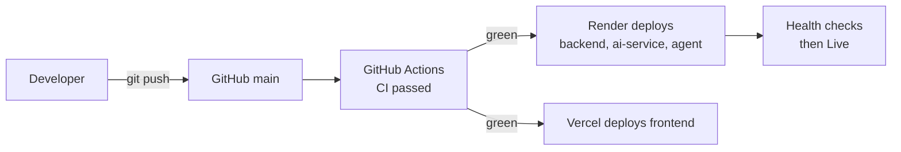

1. In MongoDB Atlas, create a database user and allow network access for Render.
2. In Render, choose **New, Blueprint**, select this repository and fill in every `sync: false` value.
3. After the first deploy, copy the real service URLs into `AI_SERVICE_URL`, `AGENT_URL` (on the backend) and `BACKEND_URL` (on the agent), then let each service redeploy.
4. Seed the database once from your own machine: `MONGODB_URI=... npm run seed` inside `backend/`.
5. In Vercel, set the root directory to `frontend`, set `BACKEND_URL` and `NEXT_PUBLIC_AGENT_WS_URL`, and redeploy. Environment changes only apply to new builds.

Free Render instances sleep after about 15 minutes of inactivity, and the first request afterward can take 30 to 60 seconds. Open each service's health URL a couple of minutes before a demo.

---

## 15. Demo accounts

These accounts are created by the seed script for evaluation. Change or remove them for any real deployment.

| Role | Email | Password |
|---|---|---|
| Admin (Dean's Office) | `admin@cit.edu` | `Admin@123` |
| Department Coordinator | `dept.cse@cit.edu` | `Dept@123` |
| Faculty (Dr. Ananya Mishra, F01) | `faculty.f01@cit.edu` | `Faculty@123` |
| Club Representative (Dramatics) | `club.dramatics@cit.edu` | `Club@123` |

An Admin can restore the demo to a clean state at any time with the reset button in the dashboard or `POST /api/admin/reset-database`.

---

## 16. Benchmark results

Produced by running the official `validator.py` on the exported files. The dashboard header shows the live values for the current schedule version.

**Baseline timetable (`exports/schedule.json`)**

| Metric | Result |
|---|---|
| Hard violations | **0** |
| Soft penalty | 310 |
| Booking score | 61.0 (20 approved, 2 alternatives offered, 3 rejected with reasons) |
| Priority inversions | 0 |
| Exam soft penalty | 0 |

**After the sample disruption (`exports/schedule_after.json`)**

| Metric | Result |
|---|---|
| Hard violations | **0** |
| Sessions moved | 9 (1 changed time, 8 changed room only) |
| Repair time | under 1 second |

Both files are generated by the application, not edited by hand.

---

## 17. Security notes

- Secrets live only in environment variables. `.env` files are git-ignored, and `.env.example` holds placeholders.
- Passwords are hashed with bcrypt, and sessions use signed, expiring JWTs.
- Every protected route enforces authentication and a role check, and approvals are Admin-only.
- Service-to-service calls use shared secrets, and the voice WebSocket requires a signed, short-lived ticket.
- The AI cannot approve, reject or apply anything. Proposals are drafts until a person with the right role approves them.
- Every approval and booking decision is written to the audit log.

---

## 18. Known limitations and roadmap

**Current limitations**

- The model covers one regular teaching week, plus the exam week and the festival week.
- The CP-SAT objective optimises S1, S5 and S6 directly. S2 (gaps), S3 (long days) and S4 (repeat lectures) are measured by the validator but not yet inside the model, which is why the baseline soft penalty is 310 rather than lower.
- Booking decisions use a priority-ordered greedy procedure. It is fast and keeps priority inversions at zero, but it is not a global optimum over alternatives.
- Natural-language dates are checked against the calendar before submission, but very ambiguous phrasing may need a follow-up question.
- Free-tier hosting causes cold starts.

**Roadmap**

- Move S2, S3 and S4 into the CP-SAT objective.
- Solve bookings jointly with the timetable so a booking can trigger the cheapest session move.
- Multi-week and semester-level planning.
- Notifications (email or push) for approvals and schedule changes.
- Calendar sync beyond the current Add to Google Calendar links.
- Utilisation and fairness analytics for administrators.

---

## 19. Documentation index

| Document | Contents |
|---|---|
| [`AI_USAGE.md`](AI_USAGE.md) | Where AI is used, what it may never decide, where the prompts live. |
| [`THIRD_PARTY.md`](THIRD_PARTY.md) | Libraries and solvers with licences. |
| [`CI-SETUP.md`](CI-SETUP.md) | Pipeline jobs and branch protection. |
| [`DEPLOYMENT.md`](DEPLOYMENT.md) | Deployment details. |
| [`KNOWN_ISSUES.md`](KNOWN_ISSUES.md) | Open issues. |
| [`CrunchWeek_StarterPack/README.md`](CrunchWeek_StarterPack/README.md) | Dataset fields, export format and validator usage. |

---

*Built by Team OrchestrAI for the Chilika Institute of Technology Crunch Week challenge.*